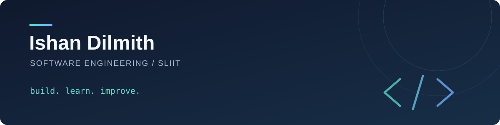

### Hey, I'm Ishan 👋

I'm a software engineering undergraduate at SLIIT who enjoys turning ideas into useful applications. I explore **full-stack development, mobile apps, microservices, and AI** through hands-on projects.

---

## 🚀 Featured work

🧠 **[EmpowerZ research portfolio](https://github.com/IshanDilmith/R26-SE-10-Portfolio)** 
A research portfolio for an AI-driven soft-skills training and feedback platform for Gen Z employees.

📝 **[Automated Assignment Grader](https://github.com/IshanDilmith/Automated-Assignment-Grader)** 
An assignment grading project with a Python repository and a separate [TypeScript client](https://github.com/IshanDilmith/Automated-Assignment-Grader-ClientSide).

📱 **[ToDo — Task Management App](https://github.com/IshanDilmith/ToDo---Task-Management-App)** 
A Kotlin mobile app for tracking tasks and managing time.

🅿️ **[ParkX](https://github.com/IshanDilmith/ParkX---Automated-Parking-System)** 
A web-based parking management system for finding and reserving parking spaces.

→ [See all repositories](https://github.com/IshanDilmith?tab=repositories)

## 🛠️ Technologies & tools

**Languages** 

**Web & data** 

**Tools** 

---

Always learning, one project at a time.

